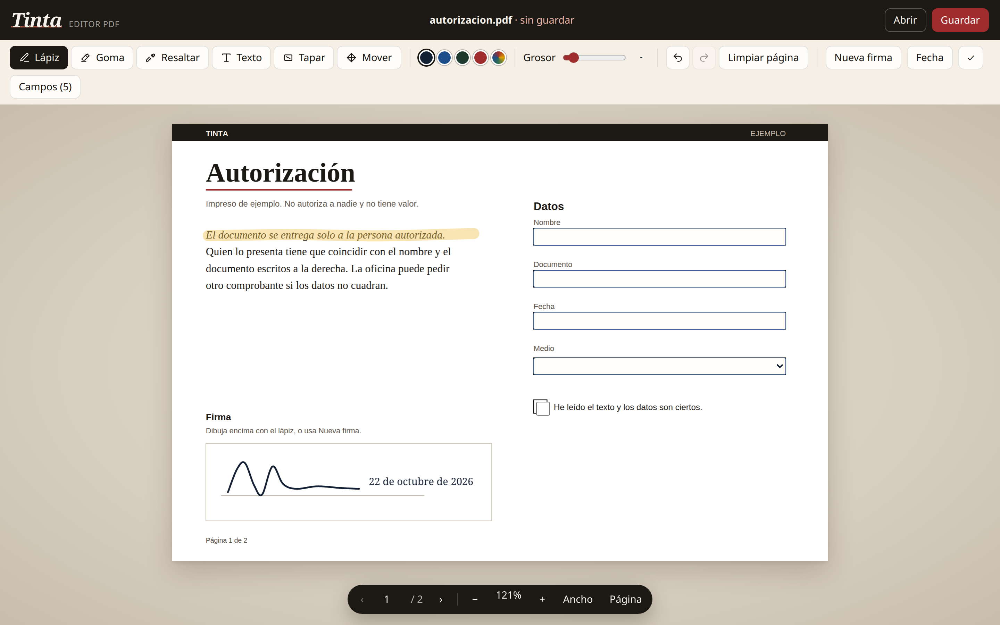
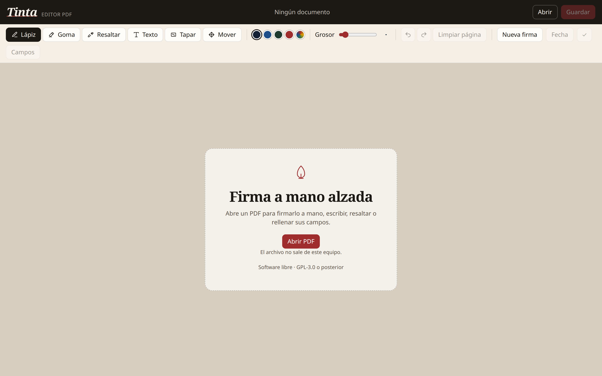
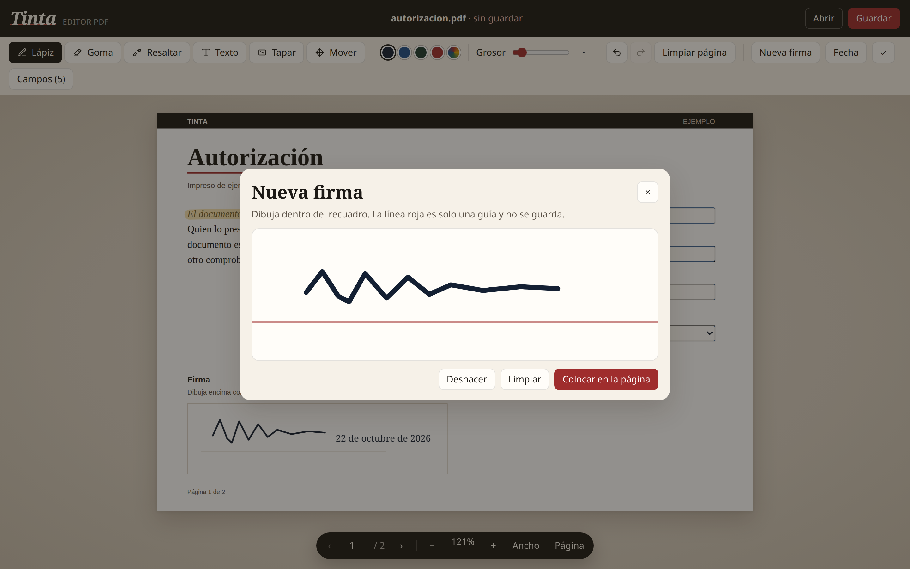
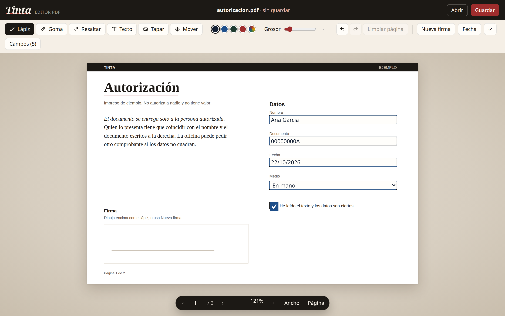

# Tinta

**Español** · [English](README.en.md) · [Asturianu](README.ast.md)

<p align="center">
  
</p>

<p align="center">
  <a href="LICENSE"></a>
  
</p>

Editor visual de PDF para el escritorio Linux. Firma a mano, escribe encima, resalta y rellena formularios. El archivo no sale de tu equipo.

<p align="center">
  
</p>

<p align="center">
  
  
</p>

## Qué es

Tinta abre un PDF en una ventana y deja dibujar sobre la página. Sirve para el impreso que hay que firmar, la fecha que falta o el campo que el otro programa no rellenó. Al guardar, escribe una copia: el original no se toca.

También se puede usar en el navegador, con el mismo editor. La aplicación de escritorio es la forma prevista: tiene diálogo de abrir y guardar, y avisa si cierras con cambios.

## Qué no es

Tinta **no** crea una firma electrónica cualificada, ni un certificado, ni una firma PAdES. Lo que dibujas es el equivalente a un bolígrafo sobre el papel. Un banco, un juzgado o una administración pueden no aceptarlo como firma legal.

**Tapar** cubre con blanco lo que se ve. No borra el texto de debajo: sigue en el archivo y se puede seleccionar. No sirve para ocultar un dato sensible.

## Qué puede hacer

- Lápiz, goma, resaltado, texto, tapar una zona y mover lo que has puesto.
- Una firma dibujada en un recuadro, que luego se puede colocar otra vez.
- Fecha de hoy y una marca de visto.
- Campos de formulario: texto, casilla, opción, lista y recuadro de firma.
- Varias páginas, zoom y ajuste al ancho o a la página.
- Abrir soltando el archivo sobre la ventana, o con `tinta documento.pdf`.
- Deshacer y rehacer.

En un PDF normal el texto sigue pudiendo seleccionarse: la tinta va encima. Si el archivo está cifrado, o no se puede modificar, Tinta guarda una copia visual y el texto deja de ser seleccionable. Lo avisa al guardar.

## Privacidad

No hay cuenta, no hay telemetría y el PDF no se sube a ningún sitio. PDF.js y pdf-lib van dentro del programa, así que tampoco hace falta red para editar. La contraseña de un archivo protegido solo se usa en memoria para poder abrirlo.

## Requisitos

Linux con Python 3, GTK 3 y WebKitGTK 4.1.

Ubuntu y Debian:

```bash
sudo apt install python3-gi gir1.2-gtk-3.0 gir1.2-webkit2-4.1
```

Fedora: `python3-gobject`, `gtk3` y `webkit2gtk4.1`.
Arch: `python-gobject`, `gtk3` y `webkit2gtk-4.1`.

## Instalación

Hace falta el código. Desde el directorio del proyecto:

```bash
git clone https://github.com/Hectronic/tinta.git
cd tinta
./install.sh --desktop
```

Eso instala, para tu usuario:

- el ejecutable `tinta` en `~/.local/bin`
- la entrada del menú de aplicaciones, asociada a los PDF
- el icono
- un lanzador en el Escritorio, si la carpeta existe

Ábrela desde el menú, desde el Escritorio, o en una terminal:

```bash
tinta
tinta examples/autorizacion.pdf
```

Para instalarla en `/usr/local`, usa `./install.sh --system` (hace falta permiso de escritura). Para quitarla: `./install.sh --uninstall`.

Sin instalar, desde el código:

```bash
./tinta
```

El manual completo, con atajos y problemas frecuentes, está en [docs/manual.es.md](docs/manual.es.md). En inglés: [docs/manual.en.md](docs/manual.en.md). En asturiano: [docs/manual.ast.md](docs/manual.ast.md).

## Uso en el navegador

El editor es la página `index.html`. Algunos navegadores bloquean el worker de PDF.js si abres el archivo directamente. Sirve un servidor local:

```bash
python3 -m http.server 8765
```

y abre <http://127.0.0.1:8765/>. En el navegador el botón dice **Descargar** en vez de **Guardar**.

## Ejemplo

[`examples/autorizacion.pdf`](examples/autorizacion.pdf) es un impreso de dos páginas, con campos, para probar. No autoriza a nadie y no tiene valor.

<p align="center">
  
</p>

## Desarrollo

```bash
python3 tinta.py --help
python3 tinta.py --self-test
```

La ventana está en `tinta.py`. El editor está en `index.html`. El mapa para quien vaya a tocar el código está en [AGENTS.md](AGENTS.md) y en [docs/desarrollo.md](docs/desarrollo.md).

## Licencia

Tinta es software libre: GNU GPL versión 3 o posterior. El texto está en [LICENSE](LICENSE). Puedes usarla, estudiarla, modificarla y redistribuirla, también en un programa comercial, siempre que el resultado siga bajo la misma licencia y entregues el código fuente.

PDF.js 3.11.174 (Mozilla) va bajo la Apache License 2.0. pdf-lib 1.17.1 (Andrew Dillon) va bajo la MIT. Esas licencias se mantienen. El detalle está en [NOTICE](NOTICE).

Copyright (C) 2026 [Hector Alvarez](https://github.com/Hectronic).
